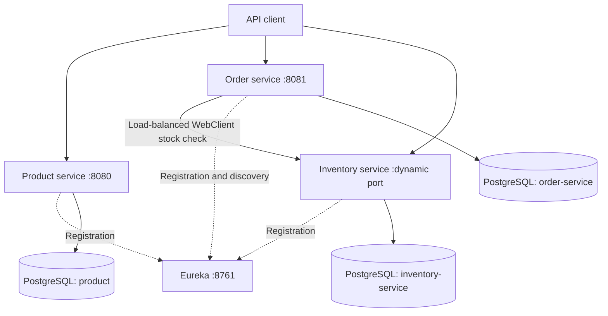

# Shopping App

A Java shopping backend organized as a Maven monorepo. The root POM is both the
parent and aggregator for four independently runnable Spring Boot services.

## Repository structure

```text
Shopping_App/
|-- pom.xml                         # Shared parent and module list
|-- .gitignore                      # Ignore rules for the entire repository
|-- .env.example                    # Environment variable reference (no secrets)
|-- discovery-server/               # Eureka service registry
|-- product-service/                # Product catalog API
|-- order-service/                  # Order placement API
`-- inventory-service/              # Stock availability API
```

All child POMs inherit from `../pom.xml`. Keep one active `.git` directory at the
repository root; the service directories are ordinary folders, not Git submodules.

## Architecture



The project declares Java 17, Spring Boot 4.1.1 and Spring Cloud 2025.1.2.
Persistence uses Spring Data JPA and PostgreSQL. Other components include Lombok,
Flyway, Eureka and Spring Cloud LoadBalancer. Tests use JUnit, MockMvc and
Testcontainers. The old MongoDB data directory and commented Compose file are
legacy artifacts; the current services use PostgreSQL.

## Prerequisites

- JDK 17 or newer, with `JAVA_HOME` pointing to the JDK.
- PostgreSQL running locally on port 5432, or accessible through the URL overrides below.
- Maven, or one of the included service Maven wrappers. Wrapper downloads and
  dependency resolution require network access on the first run.
- Docker when running the PostgreSQL Testcontainers tests.

Run commands below from the repository root unless stated otherwise.

## Database and environment setup

Create three databases using a PostgreSQL account with permission to create them.
For example, in `psql`:

```sql
CREATE DATABASE product;
CREATE DATABASE "order-service";
CREATE DATABASE "inventory-service";
```

Set credentials in **each terminal** used to launch a business service, or configure
them in each IDE run configuration. PowerShell example:

```powershell
$env:DB_USERNAME = 'postgres'
$env:DB_PASSWORD = '<your-local-database-password>'
```

On macOS/Linux, use `export DB_USERNAME='postgres'` and
`export DB_PASSWORD='<your-local-database-password>'` instead.

| Variable | Required | Default |
| --- | --- | --- |
| `DB_USERNAME` | Yes, for business services | None |
| `DB_PASSWORD` | Yes, for business services | None |
| `PRODUCT_DB_URL` | No | `jdbc:postgresql://localhost:5432/product` |
| `ORDER_DB_URL` | No | `jdbc:postgresql://localhost:5432/order-service` |
| `INVENTORY_DB_URL` | No | `jdbc:postgresql://localhost:5432/inventory-service` |

Spring Boot's standard `SPRING_DATASOURCE_URL`, `SPRING_DATASOURCE_USERNAME` and
`SPRING_DATASOURCE_PASSWORD` environment overrides can also be used per service.
Discovery does not need database credentials. `.env.example` is documentation;
Spring Boot does **not** load `.env` files automatically. Keep actual credentials
in shell/IDE environment settings or ignored local files.

### Fresh local databases

The current schema configuration assumes existing order and inventory tables:
both services have `spring.jpa.hibernate.ddl-auto=none`. The inventory Flyway script
only inserts data; it does not create the inventory table. Product uses Hibernate
`update`. Complete schema migrations are not yet supplied.

For a fresh **local development** database, set these overrides in each business
service terminal before starting the service:

```powershell
$env:SPRING_FLYWAY_ENABLED = 'false'
$env:SPRING_JPA_HIBERNATE_DDL_AUTO = 'update'
```

This lets Hibernate create the tables and disables the insert-only Flyway migration
during local setup. Keep these overrides for this development setup. Use reviewed
schema migrations before deploying to a shared or production environment.

After inventory starts and creates its table, seed the empty inventory database
once using `psql` (it prompts for your password):

```powershell
psql -h localhost -U $env:DB_USERNAME -d inventory-service -W -f inventory-service/src/main/resources/db/migration/V1__add_data.sql
```

This inserts `iPhone_1` (3 units), `iPhone_2` (4 units), and `iPhone_13` (1 unit).
Do not repeat the insert on an already seeded database. If using a remote database,
adjust the `psql` connection settings to match your inventory URL.

## Build

Build the whole Maven reactor from the root:

```powershell
mvn clean package
```

If Maven is not installed, use an existing child module's wrapper to target the
root POM:

```powershell
.\product-service\mvnw.cmd -f pom.xml clean package
```

On macOS/Linux, the equivalent is
`sh product-service/mvnw -f pom.xml clean package`.

For a packaging-only build without executing or compiling tests, use
`mvn clean package -Dmaven.test.skip=true`. This is not test validation.

Known test issues currently need attention: inventory tests still use the old
application package, and the product controller test sets `spring.data.postgres.uri`
instead of `spring.datasource.url`. The product test calls `deleteAll()`, so correct
test database isolation before running it against any valuable database. A build
with tests is not guaranteed to pass until these existing issues are resolved.

## Run locally

Start Eureka first, then inventory and product, then order. Use a separate terminal
for each process, with credentials and any local schema overrides set as above.

```powershell
# Terminal 1: discovery registry
.\discovery-server\mvnw.cmd -f discovery-server/pom.xml spring-boot:run

# Terminal 2: inventory
.\inventory-service\mvnw.cmd -f inventory-service/pom.xml spring-boot:run

# Terminal 3: products
.\product-service\mvnw.cmd -f product-service/pom.xml spring-boot:run

# Terminal 4: orders
.\order-service\mvnw.cmd -f order-service/pom.xml spring-boot:run
```

If Maven is installed, replace each wrapper invocation with `mvn` and keep the
same arguments. Open the Eureka dashboard at <http://localhost:8761> and wait for
the three business services to register before placing an order. Inventory uses
`server.port=0`; find its assigned port in its startup log or Eureka dashboard.
Order discovers inventory by service name, so it does not need that port manually.

## APIs

| Service | Method | Path | Behavior |
| --- | --- | --- | --- |
| Product | POST | `/api/product` | Create product; HTTP 201 |
| Product | GET | `/api/product` | List products; HTTP 200 |
| Order | POST | `/api/order` | Check inventory and save order; HTTP 201 on success |
| Inventory | GET | `/api/inventory?skuCodes=iPhone_1,iPhone_2` | Availability for matching SKUs; HTTP 200 |

Example PowerShell requests:

```powershell
Invoke-RestMethod -Method Post -Uri 'http://localhost:8080/api/product' -ContentType 'application/json' -Body '{"name":"Example phone","description":"Demo product","price":1000}'

Invoke-RestMethod -Uri 'http://localhost:8080/api/product'

Invoke-RestMethod -Method Post -Uri 'http://localhost:8081/api/order' -ContentType 'application/json' -Body '{"orderLineItemDtoList":[{"skuCode":"iPhone_1","price":1000,"quantity":1}]}'
```

The order example requires the inventory seed data. Product creation does not
create an inventory SKU; these are currently separate data flows.

## Current scope

- Product creation/listing, inventory availability checks and order placement.
- No frontend, authentication, cart, payment, shipping or notification module.
- Inventory checks only whether a returned SKU has quantity greater than zero;
  they do not verify the requested quantity, reserve stock or decrement it.
- Order acceptance does not verify that every requested SKU was returned, and
  prices are taken from the request rather than checked against the catalog.

## GitHub repository

Create one GitHub repository for this entire root folder. Add the service source
files as ordinary files, with no nested active Git repositories or submodules.
The root ignore rules exclude build output, IDE files, local environment files,
legacy MongoDB data and `.repo-backups/`.

During monorepo preparation, any former service `.git` directories are preserved
locally under `.repo-backups/<service>.git`. Those backups contain the former
service history and remotes; they are excluded from commits. The root repository
remains active. This preserves the old metadata locally but does not merge its
commit history into the parent repository.

Before committing or publishing, review `git status` and `git diff --cached` to
confirm that only the intended source, build configuration and documentation are
included. No GitHub repository is created or pushed by these local setup changes.
